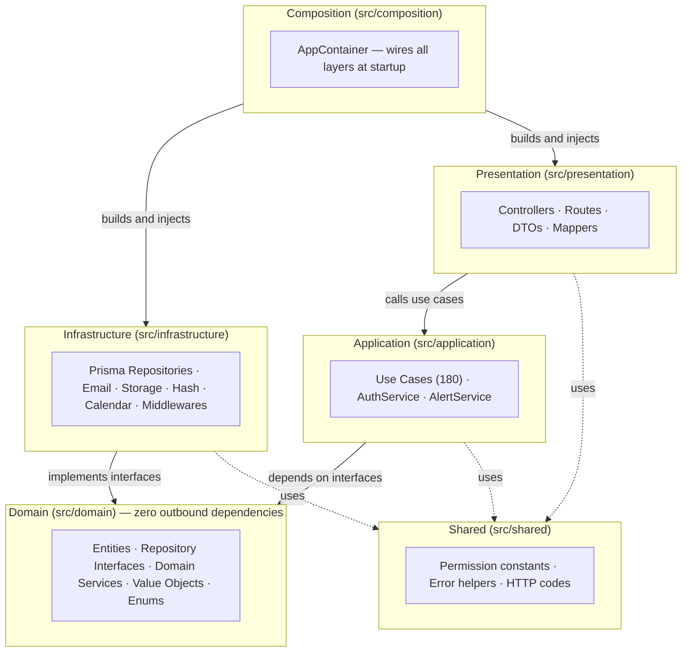
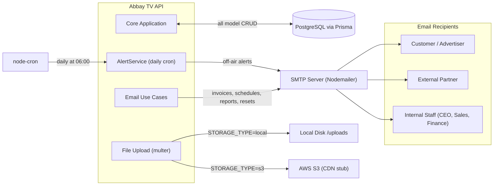
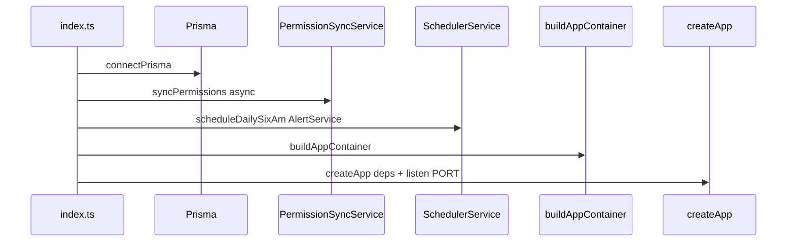

# Abbay TV Sales Automation System - Project Index

## Overview

This repository is a **single-tenant** backend API for TV sales and operations automation at Abbay TV.  
It follows a layered architecture inspired by Clean Architecture and DDD, with a **composition root** ([`src/composition/app-container.ts`](src/composition/app-container.ts)) that wires repositories and domain services; presentation still often constructs additional use-case dependencies locally (see [docs/clean-architecture-violations.md](docs/clean-architecture-violations.md)).

- **Project:** `media_automation`
- **Version:** `1.0.0`
- **Language:** TypeScript (`strict: true`), **ESM** (`"type": "module"` in [package.json](package.json))
- **Runtime:** Node.js (Prisma 7 aligns with current LTS; see team environment)
- **Framework:** Express `^5.2.1`
- **Primary database:** PostgreSQL via Prisma (client + CLI `^7.4.2`)
- **Functional requirements (canonical):** [docs/requirements.md](docs/requirements.md)  
  **Note:** [docs/requirements.mdc](docs/requirements.mdc) duplicates the same content for tooling; prefer **`requirements.md`** as the source of truth.


## Current State Snapshot

- **Single-tenant** — no tenant dimension in runtime or schema.
- **Persistence:** PostgreSQL only via Prisma ([`src/infrastructure/prisma`](src/infrastructure/prisma)); no MongoDB / Mongoose dependency in [package.json](package.json).
- **Composition:** [`buildAppContainer()`](src/composition/app-container.ts) exposes repository and service singletons; [`createApp`](src/presentation/app.ts) receives [`ApiRouterDeps`](src/presentation/api-router-deps.ts) (`AppContainer` + `storageService`, `advertPackageImageUpload`, `authMiddleware`).
- **Permissions:** DB-backed; [`PermissionSyncService`](src/infrastructure/services/permission-sync.service.ts) syncs from [`PERMISSIONS`](src/shared/constants/permissions.constants.ts) at startup (fire-and-forget).
- **Implemented HTTP areas:** Auth, users, employees, partners, permissions, user-permissions, shows, show-hosts, satellite schedules (blocks + broadcast slots), telegram groups/members, sales follow-up (customers, communication logs, media monitoring, categories, sub-categories, show segment slots), media packs, advert packages (catalog + multipart image upload), advert-package ↔ media-pack junction, **advert placements** (campaign slots tied to shows / broadcast slots), **advert sales** (deals, installments, sales rep/agent/category fields), **satellite log uploads and entries** (upload, match, verify), **compensations**, **payments**, **revenue shares**, **agent commissions**; email flows for schedules, reports, payment requests, compensation where wired.
- **Campaign model:** Prisma `AdvertPlacement` (not a separate legacy `/api/adverts` router). The old “Advert” concept was repurposed to placement-oriented modeling (see migrations under `repurpose_advert_to_placement`).
- **Alerts:** [`SchedulerService`](src/infrastructure/services/scheduler.service.ts) runs daily at **06:00** (`0 6 * * *`) → [`AlertService.processOffAirAlerts()`](src/application/services/alert.service.ts) — **fully implemented**: queries recipients by `RECEIVE_OPERATIONAL_ALERTS` permission, finds campaigns/placements ending within 24 h, sends branded HTML email to all recipients, then stamps `campaignEndAlertSentAt` / `airAlertSentAt`.
- **Analytics:** [`AnalyticsService`](src/application/services/analytics.service.ts) uses constructor-injected repository interfaces (CA violation fixed). Exposed via `GET /api/analytics/kpis`, `GET /api/analytics/monthly-revenue?year=`, `GET /api/analytics/top-shows?limit=` — all protected by `view_analytics` permission.


## Tech Stack

| Category | Technology | Version |
|----------|------------|---------|
| Runtime | Node.js | (see CI / local; Node 22+ used for Prisma 7) |
| Language | TypeScript | `^5.9.3` |
| Module system | ESM | `type: module`, NodeNext resolution |
| Dev server | tsx | `^4.19.0` |
| API | Express | `^5.2.1` |
| ORM | Prisma Client + Prisma CLI + `@prisma/adapter-pg` | `^7.4.2` |
| Database | PostgreSQL | via `DATABASE_URL` |
| Auth | jsonwebtoken | `^9.0.3` |
| Validation | Zod | `^4.3.5` |
| Hashing | bcryptjs | `^3.0.3` |
| Scheduling | node-cron | `^4.2.1` |
| Email | Nodemailer | `^7.0.12` |
| Uploads | multer | `^2.0.2` |
| HTTP middleware | cors, helmet, morgan | `^2.8.6`, `^8.1.0`, `^1.10.1` |
| Testing | Jest + Supertest | `^29.7.0`, `^7.2.2` |
| Formatting / linting | Prettier + ESLint + TS ESLint | configured |


## Top-Level Structure

```text
tvsystem_api/
├── src/
│   ├── composition/          # App container + HTTP middleware helpers
│   ├── domain/
│   ├── application/
│   ├── infrastructure/
│   ├── presentation/
│   ├── shared/
│   ├── tests/
│   └── index.ts
├── docs/
├── postman_collection.json
├── prisma.config.ts
├── PROJECT_INDEX.md
├── PROJECT_INDEX_AUTO.md
├── TODO.md
├── package.json
└── tsconfig.json
```


## Architecture and Layer Responsibilities

### 1) Domain Layer (`src/domain`)

- **Entities (`31` files):** user, employee, partner, permission, user-permissions, show, show-host, satellite-schedule, satellite-schedule-block, broadcast-slot, customer, communication-log, category, sub-category, media-monitoring-record, show-segment-slot, media-pack, advert-package, advert-package-media-pack, advert-placement, advert-sales, payment, compensation, revenue-share, agent-commission, audit-log, satellite-log, satellite-log-entry, satellite-log-upload, telegram-group, telegram-group-member.
- **Repository contracts (`31` files under `domain/repositories/`):** includes `*.repository.interface.ts`, `*.repo.ts`, `base.repository.interface.ts`, etc. (Note: 7 files use `.repo.ts` instead of `.repository.interface.ts`; filename typo `adver-sales.repository.interface.ts`.)
- **Filter/summary interfaces:** `domain/interfaces/`.
- **Domain services** (`domain/services/`): hash, calendar, email, storage port, schedule handlers, business-ref, compensation/sales-commission helpers (~10 TS files).
- **Value objects (`5`):** money, percentage, schedule-slot, calendar-date, Ethiopian time.
- **Enums (`20` TS files under `domain/enums/`):** roles, show type, advert status, payment status, broadcast slot status, customer status, revenue share type, user ref model, sex, status, broadcast type, satellite schedule status/type, day-of-week, etc.
- **Domain errors:** e.g. `EntityNotFoundError`, communication-log append-only enforcement.

### 2) Application Layer (`src/application`)

- **Services (`3`):**
  - `AuthService` — access/refresh tokens.
  - `AnalyticsService` — KPI summary, monthly revenue, top shows by revenue. Constructor-injected; exposed via `/api/analytics`.
  - `AlertService` — cron entry point, **fully implemented**: 24 h campaign-end and placement air alerts via email.
- **Use cases (`180` TS files):** grouped by feature folders including users, partners, permissions, shows, show-hosts, satellite schedules/blocks/broadcast-slots, telegram, customers, communication-logs, media-monitoring, categories, sub-categories, show-segment-slots, media-pack, advert-package, advert-package-media-pack, **advert-placements**, **advert-sales**, **satellite-log**, **compensations**, **payments**, **revenue-distribution**, **advert-schedule** (emails/reports), etc.

### 3) Infrastructure Layer (`src/infrastructure`)

Approx. **`135`** TypeScript files, notably:

- **Prisma:** client, repositories, `model_entity_mappers/`, `where_clauses/`, `exceptions.ts`, [`schema.prisma`](src/infrastructure/prisma/schema.prisma), migrations, seed.
- **Middleware:** `auth.middleware.ts` (factory), `permission.middleware.ts`, `advert-package-upload.middleware.ts`.
- **Services:** `permission-sync.service.ts`, `scheduler.service.ts`, `hash.service.ts`, calendar mirror, [`storage.factory.ts`](src/infrastructure/services/storage/storage.factory.ts) (local + S3 stub).
- **Config:** `jwt.config.ts`, `email.config.ts`, Prisma connection in [`prisma.client.ts`](src/infrastructure/prisma/prisma.client.ts).
- **External:** [`external/email/email.service.ts`](src/infrastructure/external/email/email.service.ts) and templates under `external/email/templates/`.

### 4) Presentation Layer (`src/presentation`)

- [`app.ts`](src/presentation/app.ts): JSON, CORS, Helmet, Morgan, `/api` router, static `/uploads` when not using S3, 404 + global error handler.
- **Route modules (`30` TS files including [`routes/index.ts`](src/presentation/routes/index.ts)):** nested routers under satellite schedules.
- **Controllers (`31` TS files under `controllers/`, including `health.controller.ts` and `broadcast-slot-response.formatter.ts`).**
- **Request DTOs (`81` TS files)** with Zod.
- **Query mappers (`23` files)** under `presentation/mappers/`.
- **Validators:** `validate-body.ts`, `validate-query.ts`, multipart validators for advert packages.

### 5) Shared Layer (`src/shared`)

- Permissions constants (`PERMISSIONS`), error helpers, HTTP error mapping.


## Dependency Graphs

### 1. Layer Dependency

Arrow direction represents "depends on" (A → B means A depends on B). Dashed lines show utility usage that does not cross Clean Architecture layer boundaries.




### 2. Inter-Module Dependency

Shows which feature modules depend on which other feature modules, derived from use-case constructor injections and Prisma relational constraints. An arrow A → B means "A depends on B".

```mermaid
flowchart TD
    subgraph adminHR ["Admin and HR"]
        Users["Users / Auth"]
        Employees["Employees"]
        Partners["Partners"]
        Permissions["Permissions"]
        UserPerms["User Permissions"]
        TelegramGrps["Telegram Groups and Members"]
    end

    subgraph catalogSg ["Content Catalog"]
        Shows["Shows"]
        ShowHosts["Show Hosts"]
        MediaPacks["Media Packs"]
        AdvertPackages["Advert Packages"]
        AdvertPkgMp["Advert Package - Media Pack"]
    end

    subgraph crmSg ["Sales and CRM"]
        Customers["Customers"]
        CommLogs["Communication Logs"]
        MediaMonitoring["Media Monitoring"]
        ShowSegSlots["Show Segment Slots"]
        Categories["Categories"]
        SubCategories["Sub-Categories"]
    end

    subgraph schedulingSg ["Scheduling"]
        SatSchedules["Satellite Schedules"]
        ScheduleBlocks["Schedule Blocks"]
        BroadcastSlots["Broadcast Slots"]
    end

    subgraph advertOpsSg ["Advert Operations"]
        AdvertSales["Advert Sales"]
        AdvertPlacements["Advert Placements"]
        SatelliteLogs["Satellite Logs"]
        Compensations["Compensations"]
        AdSchedule["Ad Schedule and Report Emails"]
    end

    subgraph financeSg ["Finance and Revenue"]
        Payments["Payments"]
        RevenueShares["Revenue Shares"]
        AgentCommissions["Agent Commissions"]
    end

    Employees --> Users
    Partners --> Users
    UserPerms --> Users
    UserPerms --> Permissions
    TelegramGrps --> Users

    ShowHosts --> Shows
    ShowHosts --> Users
    AdvertPackages --> Shows
    AdvertPackages --> MediaPacks
    AdvertPkgMp --> AdvertPackages
    AdvertPkgMp --> MediaPacks

    CommLogs --> Customers
    MediaMonitoring --> Customers
    ShowSegSlots --> Shows
    ShowSegSlots --> Customers
    SubCategories --> Categories

    ScheduleBlocks --> SatSchedules
    BroadcastSlots --> SatSchedules
    BroadcastSlots --> ScheduleBlocks
    BroadcastSlots --> Shows

    AdvertSales --> Customers
    AdvertSales --> AdvertPackages
    AdvertSales --> Users
    AdvertSales --> Categories
    AdvertSales --> SubCategories
    AdvertPlacements --> AdvertSales
    AdvertPlacements --> Shows
    AdvertPlacements --> BroadcastSlots
    SatelliteLogs --> AdvertPlacements
    Compensations --> AdvertPlacements
    AdSchedule --> AdvertSales
    AdSchedule --> AdvertPlacements

    Payments --> AdvertSales
    RevenueShares --> AdvertSales
    RevenueShares --> ShowHosts
    AgentCommissions --> AdvertSales
    AgentCommissions --> Users
```




### 3. External Integration

Shows how the API communicates with external systems at runtime.




## Composition (`src/composition`)

- **`app-container.ts`** — Builds concrete Prisma repositories and infrastructure services (`HashService`, `CalendarService`, `EmailService`, `GenerateBusinessRefService`) into an `AppContainer` consumed by controllers via factory functions.
- **`http-middlewares.ts`** — Shared helpers such as `requirePermission` used by routes.


## Bootstrap and Runtime Flow

### Startup ([`src/index.ts`](src/index.ts))

1. Load env via `import 'dotenv/config'`.
2. `connectPrisma` ([`src/infrastructure/prisma`](src/infrastructure/prisma)).
3. `PermissionSyncService.syncPermissions()` in background.
4. `SchedulerService.scheduleDailySixAm` → `AlertService.processOffAirAlerts`.
5. `buildAppContainer()` → `createApp({ ...container, storageService, advertPackageImageUpload, authMiddleware })`.
6. Listen on `PORT` (default `3000`).
7. Graceful shutdown on `SIGTERM` / `SIGINT` (server close + `disconnectPrisma`).



### Request execution flow

1. `presentation/routes/*` selects endpoint.
2. Zod validation (`validateBody` / `validateQuery` / multipart).
3. `authMiddleware` verifies Bearer JWT and sets `req.user`.
4. `requirePermission` checks permission slug.
5. Controller factory receives `ApiRouterDeps` and invokes use cases.
6. Use case uses repository interfaces (Prisma implementations).
7. Success envelope or global error handler.


## Requirements ↔ Backend (from [docs/requirements.md](docs/requirements.md))

| Section | Topic | Backend status (API / notes) |
|---------|--------|------------------------------|
| 4.1 | Shows management | `GET/POST/PATCH/DELETE /api/shows` |
| 4.2 | Satellite scheduling | `/api/satellite-schedules`, nested `.../blocks`, `.../broadcast-slots` |
| 4.3 | Sales follow-up | `/api/customers`, `/communication-logs`, `/media-monitoring`, `/categories`, `/sub-categories`, `/show-segment-slots` |
| 4.4 | Advert sale | `/api/advert-sales`; contract docs generation not fully automated |
| 4.5 | Advert placement | `/api/advert-placements` (linked to shows / broadcast slots) |
| 4.6 | Ad schedule and reporting | Use cases under `advert-schedule/` (emails, reports); verify product coverage vs §4.6 |
| 4.7 | Schedule vs satellite log | `/api/satellite-logs` (upload, match, verify), `/api/satellite-log-entries`; customer compensation approval via email may need front-end + token flows |
| 4.8 | Advert finance | `/api/payments` + payment-request email use cases |
| 4.9 | Revenue share and commission | `/api/revenue-shares`, `/api/agent-commissions`, `revenue-distribution/` use cases |
| 4.10 | Employee management | `/api/employees` |
| 4.11 | Partner management | `/api/partners` |
| 4.12 | Users and permissions | `/api/auth`, `/api/users`, `/api/permissions`, `/api/user-permissions` |
| 4.13 | Media pack management | `/api/media-packs`, `/api/advert-packages`, `/api/advert-package-media-packs` |
| 4.14 | Analytics | **No REST surface**; `AnalyticsService` exists but unused |
| 4.15 | Revenue share report emails | Partially addressed via revenue-share + email stack; confirm scheduling vs §4.15 |
| §3 / §5 | SMS, audit logging, NFRs | SMS not in stack; audit logging not a dedicated middleware; HTTPS/ops are deployment concerns |

This table is indicative; detailed behavior must match the code and product sign-off.


## Module and Endpoint Index

All routes are mounted under **`/api`** via [`createApiRouter`](src/presentation/routes/index.ts).

| Module | Base path | Route file(s) | Primary controller(s) | Notes |
|--------|-----------|---------------|------------------------|-------|
| Health | `/health` | `routes/index.ts` | `health.controller.ts` | Public |
| Auth | `/auth` | `auth.routes.ts` | `auth.controller.ts` | Login, register, refresh |
| Users | `/users` | `users.routes.ts` | `user.controller.ts` | Admin + `me` |
| Shows | `/shows` | `shows.routes.ts` | `show.controller.ts` | CRUD |
| Show hosts | `/show-hosts` | `show-hosts.routes.ts` | `show-host.controller.ts` | Host assignment + revenue metadata |
| Permissions | `/permissions` | `permissions.routes.ts` | `permission.controller.ts` | CRUD/query |
| User permissions | `/user-permissions` | `user-permissions.routes.ts` | `user-permission.controller.ts` | Grant/revoke/list |
| Employees | `/employees` | `employees.routes.ts` | `employee.controller.ts` | Employee + linked user |
| Partners | `/partners` | `partners.routes.ts` | `partner.controller.ts` | CRUD + status |
| Media packs | `/media-packs` | `media-packs.routes.ts` | `media-pack.controller.ts` | CRUD + `POST .../with-ad-packages` |
| Advert packages | `/advert-packages` | `advert-packages.routes.ts` | `advert-package.controller.ts` | Multipart create/update; `storageService` |
| Advert placements | `/advert-placements` | `advert-placements.routes.ts` | `advert-placement.controller.ts` | Campaign / placement CRUD |
| Advert-package ↔ media-pack | `/advert-package-media-packs` | `advert-package-media-packs.routes.ts` | `advert-package-media-pack.controller.ts` | Junction CRUD |
| Advert sales | `/advert-sales` | `advert-sales.routes.ts` | `advert-sales.controller.ts` | Deals, installments |
| Satellite schedules | `/satellite-schedules` | `satellite-schedules.routes.ts` (+ nested) | `satellite-schedule.controller.ts` | CRUD, `with-blocks` |
| Schedule blocks | `/satellite-schedules/:scheduleId/blocks` | `schedule-blocks.routes.ts` | `schedule-block.controller.ts` | CRUD + batch |
| Broadcast slots | `/satellite-schedules/:scheduleId/broadcast-slots` | `broadcast-slots.routes.ts` | `broadcast-slot.controller.ts` | List/update/delete; materialize slots |
| Satellite logs | `/satellite-logs` | `satellite-logs.routes.ts` | `satellite-log.controller.ts` | Upload, list, match, verify |
| Satellite log entries | `/satellite-log-entries` | `satellite-logs.routes.ts` | `satellite-log.controller.ts` | Manual match on entry |
| Compensations | `/compensations` | `compensations.routes.ts` | `compensation.controller.ts` | Plans, email, customer response |
| Payments | `/payments` | `payments.routes.ts` | `payment.controller.ts` | Payment requests, overdue checks |
| Revenue shares | `/revenue-shares` | `revenue-shares.routes.ts` | `revenue-share.controller.ts` | Partner share workflows |
| Agent commissions | `/agent-commissions` | `agent-commissions.routes.ts` | `agent-commission.controller.ts` | Agent commission workflows |
| Customers | `/customers` | `customers.routes.ts` | `customer.controller.ts` | Sales follow-up |
| Communication logs | `/communication-logs` | `communication-logs.routes.ts` | `communication-log.controller.ts` | Append-only log |
| Media monitoring | `/media-monitoring` | `media-monitoring.routes.ts` | `media-monitoring.controller.ts` | Competitor tracking |
| Categories | `/categories` | `categories.routes.ts` | `category.controller.ts` | |
| Sub-categories | `/sub-categories` | `sub-categories.routes.ts` | `sub-category.controller.ts` | |
| Show segment slots | `/show-segment-slots` | `show-segment-slots.routes.ts` | `show-segment-slot.controller.ts` | Show + customer per row |
| Telegram groups | `/telegram-groups` | `telegram-groups.routes.ts` | `telegram-group.controller.ts` | |
| Telegram group members | `/telegram-group-members` | `telegram-group-member.routes.ts` | `telegram-group-member.controller.ts` | |
| Analytics | `/analytics` | `analytics.routes.ts` | `analytics.controller.ts` | `VIEW_ANALYTICS`; KPIs, monthly revenue, top shows |


## Data Model Index (Prisma)

Prisma schema: [`src/infrastructure/prisma/schema.prisma`](src/infrastructure/prisma/schema.prisma)  
Prisma CLI config: [`prisma.config.ts`](prisma.config.ts)

### Enums in Prisma

- `UserRefModel`: `Partner`, `Employee`, `Internal`
- `SalesCommissionType`: `Percentage`, `Fixed`

### Models (tables)

- `User`, `Show`, `ShowHost`
- `Category`, `SubCategory`
- `Customer`, `CommunicationLog`, `MediaMonitoringRecord`, `ShowSegmentSlot`
- **`AdvertPlacement`** — scheduled campaign / placement (linked to show, customer, optional `broadcastSlotId`)
- **`AdvertSales`** — commercial deal record (sales rep, optional agent, categories, installments)
- `Partner`, `Employee`
- **`Payment`**
- **`Compensation`**
- `SatelliteSchedule`, `SatelliteScheduleBlock`, `BroadcastSlot`
- **`SatelliteLogUpload`**, **`SatelliteLogEntry`**
- `MediaPack`, `AdvertPackage`, `AdvertPackageShow`, `AdvertPackageMediaPack`
- `TelegramGroup`, `TelegramGroupMember`
- `Permission`, `UserPermission`
- **`RevenueShare`**, **`AgentCommission`**

### Migration status

**48** SQL migration folders under [`src/infrastructure/prisma/migrations`](src/infrastructure/prisma/migrations) (each with `migration.sql`).


## Security Model

### Authentication

- JWT access + refresh via `AuthService`.
- Access token includes user identity and resolved permission slugs.
- `authMiddleware` (factory) reads Bearer token and sets `req.user`.

### Authorization

- Permission slugs: [`src/shared/constants/permissions.constants.ts`](src/shared/constants/permissions.constants.ts).
- `requirePermission(slug)` on protected routes.
- `PermissionSyncService` ensures DB rows exist for defined permissions at startup.


## Error Handling Strategy

- Domain/application errors → HTTP mapping in [`src/shared/utils/global-error-handler.ts`](src/shared/utils/global-error-handler.ts).
- Prisma errors → [`src/infrastructure/prisma/exceptions.ts`](src/infrastructure/prisma/exceptions.ts) (`P2002`, `P2003`, `P2025`, fallback).
- Validation failures → normalized client errors via shared `Exception` + codes.


## Background Jobs and Async Processes

- Daily cron (`0 6 * * *`) → `AlertService.processOffAirAlerts()` — fully implemented: 24 h campaign-end and placement air alerts emailed to users with `RECEIVE_OPERATIONAL_ALERTS` permission.
- Permission sync: fire-and-forget on bootstrap.


## Dependencies by Concern

- API: `express`, `cors`, `helmet`, `morgan`, `multer`
- Data: `@prisma/client`, `prisma`, `@prisma/adapter-pg`
- Auth: `jsonwebtoken`, `bcryptjs`
- Validation: `zod`
- Scheduling: `node-cron`
- Email: `nodemailer`
- Utilities: `dotenv`, `dayjs`, `uuid`, `ethiopian-calendar-date-converter`, `generate-password`
- Dev/test: `typescript`, `tsx`, `jest`, `ts-jest`, `supertest`, ESLint, Prettier


## Build, Run, and Test

Scripts ([package.json](package.json)):

- `npm run dev` — `tsx watch src/index.ts`
- `npm run build` — `prisma generate && tsc`
- `npm run start` — `node --import tsx dist/index.js`
- `npm run lint` — ESLint on `src/**/*.{ts,tsx}`
- `npm run format` — Prettier
- `npm run test` — Jest (serial, ESM config in `jest.config.mjs`)

### Tests present (13 spec files)

- [`src/tests/integration/health.spec.ts`](src/tests/integration/health.spec.ts)
- [`src/tests/unit/money.spec.ts`](src/tests/unit/money.spec.ts)
- [`src/tests/unit/advert-package-media-pack-query-options.mapper.spec.ts`](src/tests/unit/advert-package-media-pack-query-options.mapper.spec.ts)
- [`src/tests/unit/advert-sales-query-options.mapper.spec.ts`](src/tests/unit/advert-sales-query-options.mapper.spec.ts)
- [`src/tests/unit/create-customer.use-case.spec.ts`](src/tests/unit/create-customer.use-case.spec.ts)
- [`src/tests/unit/create-media-monitoring-record.use-case.spec.ts`](src/tests/unit/create-media-monitoring-record.use-case.spec.ts)
- [`src/tests/unit/create-show-segment-slot.use-case.spec.ts`](src/tests/unit/create-show-segment-slot.use-case.spec.ts)
- [`src/tests/unit/delete-category.use-case.spec.ts`](src/tests/unit/delete-category.use-case.spec.ts)
- [`src/tests/unit/delete-sub-category.use-case.spec.ts`](src/tests/unit/delete-sub-category.use-case.spec.ts)
- [`src/tests/unit/show-segment-slot-to-query-options.mapper.spec.ts`](src/tests/unit/show-segment-slot-to-query-options.mapper.spec.ts)
- [`src/tests/unit/update-category.use-case.spec.ts`](src/tests/unit/update-category.use-case.spec.ts)
- [`src/tests/unit/update-customer-media-monitoring.use-case.spec.ts`](src/tests/unit/update-customer-media-monitoring.use-case.spec.ts)
- [`src/tests/unit/update-sub-category.use-case.spec.ts`](src/tests/unit/update-sub-category.use-case.spec.ts)


## Environment Variables

| Variable | Purpose | Notes |
|----------|---------|--------|
| `PORT` | HTTP port | default `3000` |
| `DATABASE_URL` | PostgreSQL for Prisma | required |
| `JWT_SECRET` | JWT signing | required in production |
| `NODE_ENV` | Environment mode | error detail, Prisma logging |
| `SMTP_HOST`, `SMTP_PORT`, `SMTP_EMAIL`, `SMTP_PASSWORD` | SMTP | used by [`email.config.ts`](src/infrastructure/config/email.config.ts) |
| `FROM_EMAIL`, `FROM_NAME` | Outbound sender | defaults in email config |
| `DEFAULT_PASSWORD` | Default hash for new users in some DTOs | e.g. employee/partner/user create |
| `STORAGE_TYPE` | `s3` vs local | [`storage.factory.ts`](src/infrastructure/services/storage/storage.factory.ts) |
| `BASE_URL` | Public base for local storage URLs | local disk uploads |
| `CDN_MOCK_BASE_URL` | Optional stub CDN base | S3 stub |
| `VAT_RATE`, `OTHER_TAXES_RATE` | Tax calculation for advert packages | optional; defaults `0` |


## Known Gaps and Technical Debt
- **SMS** integration (requirements context §3) **not** in dependencies; email only.
- **[docs/clean-architecture-violations.md](docs/clean-architecture-violations.md)** is out of date (references legacy `/api/adverts`, removed Mongo config, and pre-dates current payment/compensation/satellite-log modules) — refresh recommended.
- **Duplicate requirements file:** [`docs/requirements.mdc`](docs/requirements.mdc) — consolidate or deprecate in favor of [`docs/requirements.md`](docs/requirements.md).
- **`docs/technical_specifications.mdc`** may still reference older shapes; align with Prisma + single-tenant reality when edited.
- Layering: controllers may still instantiate repositories directly alongside `AppContainer`; see clean-architecture doc.


## Approximate File Count Summary

| Area | Count (approx., Apr 2026) |
|------|---------------------------|
| TypeScript files under `src/` | ~672 |
| Domain entities | 31 |
| Domain repository contract files | 31 |
| Domain enum files | 20 |
| Domain value-objects | 5 |
| Application services | 3 |
| Application use-cases | 180 |
| Infrastructure TS files | 135 |
| Presentation route TS files | 30 |
| Presentation controllers | 31 |
| Presentation DTO TS files | 81 |
| Presentation mappers | 23 |
| Prisma migrations (`migration.sql`) | 48 |
| Test spec files | 13 |


## References

- **Functional requirements (canonical):** [docs/requirements.md](docs/requirements.md)
- **Duplicate requirements doc:** [docs/requirements.mdc](docs/requirements.mdc) (prefer `.md`)
- Architecture debt: [docs/clean-architecture-violations.md](docs/clean-architecture-violations.md)
- Legacy notes: [docs/technical_specifications.mdc](docs/technical_specifications.mdc)
- API collection: [postman_collection.json](postman_collection.json)
- Tasks: [TODO.md](TODO.md)


*Last Updated: April 22, 2026 — AnalyticsService CA fix + /api/analytics endpoints*
